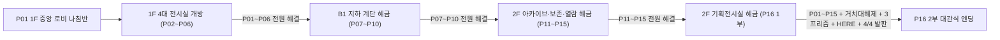
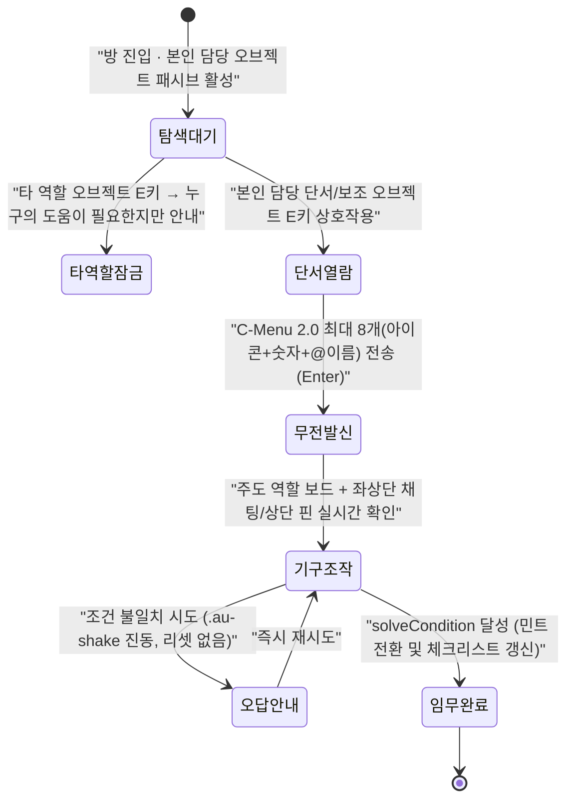

# STRANGER 2.0 · 퍼즐 & 협동 시스템 마스터 명세서

> **프로젝트**: UNESCO PARALLAX 4인 협동 픽셀 미스터리 게임 **STRANGER 2.0** (태풍으로 정전·침수된 필리핀 역사박물관)  
> **실배포 URL**: https://stranger-2.vercel.app  
> **기준 브랜치**: `main` (PR #4 포탈 정렬 + 상단 벽면 보행 보정 + 역할 완전 분리 + 3단계 비주얼 무전·상단 채팅 정리 + `feature/kid-picture-ui` 그림 UI + 공식 로고 + 원판 6장 스토리 반영)  
> **대상 연령**: 초등학교 5~6학년 ~ 중학교 1학년 (11~15세 · 비언어+수치+지명 협동, 시각 단서 기반, 오답 페널티 없이 즉각 재시도)  
> **월드 규모**: `2048×1664px` (`1F · B1 · 2F` 총 14개 씬 / 퍼즐 바인딩 오브젝트 **69개** / 무반복 퍼즐 **16종**)

---

## 1. 4인 고정 역할, 역할별 완전 분리 & 패시브 HUD (`4:4:4:4` 균등 분배)

네 명의 조사단원은 입장 시 부여받은 직업을 탐색·이동·퍼즐 전 과정에 걸쳐 유지하며, 각자 맡은 단서와 장치가 엄격히 분리됩니다.

| 캐릭터 (국적) | 코드 키 | 직업 · 역할 | 배지 / 컬러 | 평상시 탐색 HUD 패시브 (본인 담당 오브젝트 전용) | 주도 (`main`) 4퍼즐 | 단서·보조 (`helper`) 퍼즐 | 피날레 |
| :--- | :---: | :--- | :---: | :--- | :--- | :--- | :---: |
| **서하린** (`한국`) | `doyun` | **엔지니어 · 조작자** | ⚙ `#FFB86B` | 기계·밸브·로프·배전반 주변 황동 기어 회전 하이라이트 | `P05, P07, P08, P09` | `P03, P10, P11, P13, P14, P16(1부)` | `P16(4/4)` |
| **이안** (`필리핀`) | `maria` | **고문서학자 · 통역** | 📜 `#E6C886` | 방명록·연표·바이바이인·스페인어 사료 양피지 번역 오버레이 | `P04, P11, P12, P15` | `P01, P02, P06, P13, P16(1부)` | `P16(4/4)` |
| **린** (`베트남`) | `lin` | **공간측량사 · 네비게이터** | 🧭 `#52EFBF` | 실시간 방위 벡터점선·정밀 좌표 크로스헤어 + 미니맵 미해결 핀·경로선 | `P01, P06, P10, P16` | `P04, P07, P09, P12, P15` | `P16(집결 호출)` |
| **카이** (`남아공`) | `aisha` | **유물감식가 · 관측자** | 🔍 `#7CD8FF` | 회화·직물·청동 수조 루페 레티클 & 실시간 센서(PSI·% RH·UV·pH) 뷰 | `P02, P03, P13, P14` | `P05, P08, P09, P10, P11` | `P16(4/4)` |

### 1-1. 역할별 퍼즐 및 월드 시야 완전 분리 규격
- **상대방 단서·조작 비공개 (`TaskModal`)**:
  - 기존 교차 탭(`main`/`clue`)과 전체 스포일러 오브젝트 표를 제거했습니다.
  - 한 플레이어가 타 역할의 오브젝트(`getObjectOwnerRole(obj, pDef) !== myRole`)를 열면 **잠금 안내 카드(`au-locked-role-card`)**만 표시됩니다. 단서 내용이나 조작 보드는 숨기고, 오직 **"주도 역할"과 "누구의 도움이 필요한지"**, 그리고 현재 방에서 내 역할이 맡은 오브젝트 위치만 안내합니다.
  - 조력자(`helperRoles`)가 본인 담당 단서 오브젝트를 열면 **오직 자신의 `roleClues[myRole]` / `objectRoleClues[obj.id]` 단서와 본인 전용 장치만** 표시되며, 다른 조력자의 단서나 주도자의 조작 보드는 열리지 않습니다.
- **멀티 협동 자동 잠금 (`soloSwitchEnabled`)**:
  - 2명 이상의 인간 플레이어가 방에 참가하면 `soloSwitchEnabled = false`로 자동 고정되어 캐릭터 전환(`Tab`)을 통한 타 역할 엿보기를 차단합니다. (1인 솔로/테스트 모드에서만 `soloSwitchEnabled = true` 허용)
- **다중 조력자 퍼즐 장치 분리**:
  - **P09 (`B1 · power`)**: 린(`power-ups-e1/2` 단락 점검) · 카이(`power-conduit` 60Hz 예열 계측) · 서하린(`power-switchgear`/`generator` 주도 조작).
  - **P10 (`B1 · rescue`)**: 카이(`rescue-dehumid-nw` 45% RH / 18°C 조절 시 안개 제거 + 침수 좌표) · 서하린(`rescue-crate-sw1/2` `crateLatch` 걸쇠 체결) · 린(`rescue-table-c` 크레인 조작, 카이/서하린 완료 여부는 읽기 전용 상태 칩으로만 확인).
  - **P11 (`2F · archive`)**: 카이(`archive-paint` UV 모음점 판독) · 서하린(`archive-long-nw/ne` 활자 목판 대조) · 이안(`archive-table` 암호판 조작).
  - **P12 (`2F · archive`)**: 린(`archive-side-desk-e` 마이크로필름 XY 스캐너 조작 및 읽기 전용 좌표/상태) · 이안(`archive-cabinet-ne` 4×4 천공 카드 타공, XY 스캐너 비공개).
  - **P13 (`2F · preserve`)**: 이안(`preserve-wall-chart` 화학 배합표 번역) · 서하린(`preserve-cabinet-1/2` 시약 공급 안전 밸브 `valveOpen` 개방) · 카이(`preserve-lab-c` 스포이드 적정 및 초음파 세척, 밸브 스위치 비공개).
  - **P16 (`2F · special`)**: 이안(`special-wall-art` 항로 비문 M1=45°, M2=135°) · 서하린(`special-boat-nw` 프리즘 거치대 베어링 잠금 해제 `mountUnlocked` + 각인 M3=90°) · 린(`special-table` 프리즘 회전 및 2부 집결 호출).

### 1-2. 역할 패시브 & HUD 정체성 강화
- **월드 패시브 격리 (`worldEngine.ts`)**: `drawRolePassiveOverlay`는 현재 활성 플레이어가 담당하는 오브젝트에만 고유 오버레이(황동 기어·양피지 번역·측량 방위선+좌표·루페 레티클)를 그립니다. 타 역할 오브젝트는 가까이 접근 시(`<= 105px`) 흐린 잠금 배지(`🔒 <이름> 담당`)만 표시합니다.
- **네비게이터 전용 미니맵 (`minimap.ts`)**: 미해결 퍼즐 핀과 진행 방향 시안색 웨이포인트 벡터선은 네비게이터(**린**) 플레이어에게만 표시됩니다.
- **실시간 방 담당 표시 (`#hud-role-box`)**: 좌상단 역할 HUD에 현재 진입한 방에서 내가 `주도`, `단서/지원`, 또는 `동료 지원` 중 어떤 임무를 맡고 있는지 즉시 표기됩니다.

### 1-3. 스마트 AI 봇 협동 (`BotController`)
- 혼자 또는 빈 슬롯에 AI 봇이 배정된 경우, 봇은 호스트 클라이언트(`room.hostClientId === clientId`) 제어 아래 다음 행동을 수행합니다:
  1. 현재 플레이어와 같은 방으로 이동 후, 본인이 담당한 미해결 보조 오브젝트 좌표로 보행 충돌(`canMove`)을 준수해 직접 걸어갑니다.
  2. 도착 즉시 필요한 장치 상태(`P10` 제습/걸쇠, `P12` XY 초점, `P13` 시약 밸브, `P16` 거치대 잠금해제)를 실행합니다.
  3. 퍼즐의 `mainRole`을 수신자로 지정해 **조합 토큰 + 숫자 수치 + 한국어 핵심 설명(`note`)**을 상단 무전 채팅으로 보고합니다.
  4. 플레이어가 무전 휠에서 `@봇이름`을 지정하거나 멘션 토큰으로 호출하면(`onRadioDirectedAtBot`, 봇 발신 패킷 제외 루프 방지), 보낸 플레이어가 있는 방의 단서를 즉시 처리·회신하거나 타 구역 임무 위치를 안내합니다.

---

## 2. 조합형 전술 무전 & 상단 팀 채팅 (`C-Menu 2.0` · 3단계 작성기)

`C` 키 또는 좌상단 팀 채팅 `[+ 보내기 (C)]` 버튼으로 **3단계 비주얼 무전 작성기**(`CMenuWheel`)를 열어 **1. 받는 사람 → 2. 단일 조합 미리보기(최대 8개) → 3. 4줄 20아이콘 · 3×4 숫자 키패드 · `@이름` 멘션**을 선택해 `Enter` 또는 `[📡 보내기]`로 전송합니다.

### 2-1. 20토큰 + 확장 조합 항목 상세 일람표

| 분류 | 항목 / 표기 | 코드 (`id`) | 아이콘 / 컬러 | 설명 & 활용 |
| :--- | :---: | :--- | :---: | :--- |
| **수신자 & 멘션** | `📢 전체` / `@서하린` / `@이안` / `@린` / `@카이` | `targetRoleId` / `ROLE:<roleId>` | 역할 컬러 배지 | 1단계 상단 수신자 지정 및 3단계 `2×2` 본문 내 `@이름` 멘션 칩 추가 (AI 봇 즉시 응답 연동) |
| **직접 숫자 입력** | 숫자 입력창 & `3×4` 키패드 (`0~9 · . · /`) | `VAL:<number>` | `🔢 <수치>` / 골드 강조 | `180`, `25`, `50`, `100`, `45/18`, `7.0`, `45/135`, `90` 등 임의의 수치 조합 전송 |
| **① 순서 (5종)** | `1번`~`4번`, `기준(0)` | `NUM_1`~`NUM_4`, `NUM_0` | `①~④`, `◎0` | 슬롯·크레이트·밸브·열 번호 및 `0°` 정렬 |
| **② 방향 (5종)** | `북 ↑`, `동 →`, `남 ↓`, `서 ←`, `회전 ↻` | `DIR_N/E/S/W`, `ACT_ROT` | `#52EFBF`, `#FFB86B` | 방위·우회 방향·턴테이블/도면 회전 지시 |
| **③ 그림 (6종)** | `태양 ☀`, `파도 🌊`, `산맥 ⛰`, `별자리 ★`, `열기 ⚡`, `안정 🛡` | `SYM_SUN/WAVE/MTN/STAR/VOLT/SAFE` | 고유 3요소 색+아이콘 | 실 색·시약·천공 열·과압/안전 상태 |
| **④ 신호 (4종)** | `준비 완료 ✔`, `잠깐 대기 ✋`, `반전/교체 ⇄`, `집결 호출 📍` | `COOP_OK/WAIT/SWAP/HERE` | `#52EFBF`~`#C792EA` | 밸브/예열 완료, 대각선/모선 우회, 2F 반원 홀 집결 |

### 2-2. 상단 통합 HUD & 팀 채팅 배치 규격
- **좌상단 통합 미션·역할 카드 (`.hud-top-left .hud-mission-card`)**: 진행률(`🧩 N / 16`), 현재 목표, 접이식 퍼즐 목록(유물 그림 포함) 아래 구분선으로 본인 역할·현재 방 임무 배지(`★ 주도` / `💡 지원`)를 하나의 반투명 글래스 카드에 통합했습니다.
- **좌상단 팀 채팅 패널 (`#hud-log-box`)**: 미션 카드 바로 아래에 **기본 펼침(`logExpanded = true`)** 으로 배치되며, 메시지 수 카운트, `▸ 받는이` 플랫 인라인 표기, 왼쪽 컬러 강조선 카드, 한국어 안내 문구 우선 표시 + 하단 콤팩트 토큰 칩(`+` 구분자 제거)으로 가독성을 높였습니다.
- **상단 배너 & 모달 상단 핀**: 수신 패킷을 상단 중앙 배너로 **4.8초간** 띄워 맵 시야를 가리지 않으며, 열린 퍼즐 모달 우측 상단에도 **최근 무전 2건**을 요약 고정합니다.

---

## 3. 4막 진행 구조, 구역 잠금 게이트 & 난이도 프리셋

### 3-1. 진행 흐름 & 구역 잠금 (`getPortalLockReason`)

| 대상 문 / 포탈 (`portal.id`) | 잠금 해제 조건 | 안내 메시지 |
| :--- | :--- | :--- |
| `life-door`, `time-door`, `craft-door`, `city-door` | `P01` 클리어 | 먼저 1F 중앙 로비 나침반(P01)을 정렬해 4대 전시관을 개방하세요! |
| `b1` (1F → B1 지하 계단) | `P01 ~ P06` (1막 전체) 클리어 | 1막(1F 전시관 P01~P06)을 모두 복원해야 지하 B1 계단이 열립니다! |
| `up` (B1 → 2F 상층 계단) | `P07 ~ P10` (2막 전체) 클리어 | 2막(B1 설비·전력 P07~P10)을 모두 복구해야 2층 계단이 열립니다! |
| `special-door` (2F → 기획전시실) | `P11 ~ P15` (3막 전체) 클리어 | 3막(2F 아카이브·보존·열람 P11~P15)을 모두 복원해야 기획전시실이 열립니다! |
| `P16` 2부 대관식 (`gather-1~4`) | `P01 ~ P15` 클리어 + `beamReachedAtrium` + `hereSent` + 4인 동시 착지 | 미완료 시 `P01~P15 먼저 복원 필요` 안내 표시 |

### 3-2. 난이도 프리셋 (`getDifficultyConfig`)

| 항목 | `쉬움` | `보통` (기본값) | `어려움` | 설명 |
| :--- | :---: | :---: | :---: | :--- |
| `showTargetHints` (목표값 힌트 표시) | `true` | `false` | `false` | `보통`/`어려움`에서는 보드 내 목표 수치·정답 색상 스포일러 숨김 |
| `p08DriftPerSec` (P08 보일러 압력 상승) | `0 PSI/s` | `3.5 PSI/s` | `6.0 PSI/s` | `보통` 이상에서는 압력이 실시간으로 다시 상승 |
| `p08RpmTolerance` (P08 펌프 RPM 오차) | `±50` | `±30` | `±20` | 1·2호기 회전수 일치 허용 오차 |
| `p09HoldMs` (P09 발전기 예열 유지 시간) | `1200ms` (1.2초) | `2000ms` (2.0초) | `2500ms` (2.5초) | 예열 스위치를 떼지 않고 유지해야 하는 시간 |
| `p14HoldMs` (P14 밀랍 인장 압착 시간) | `1200ms` (1.2초) | `2000ms` (2.0초) | `2500ms` (2.5초) | 황동 인장 프레스 유지 시간 |
| `p15TolerancePx` (P15 도면 앵커 허용 오차) | `±14px` | `±8px` | `±6px` | 3개 성곽 기준 핀 정합 판정 반경 |

---

## 4. 16개 무반복 퍼즐 마스터 일람표 (`P01` ~ `P16`)

| ID | 층 · 구역 | 퍼즐 제목 | 메커니즘 아키타입 (무반복 16종) | 보조/단서 → **주도 조작** | 대표 주도 오브젝트 | 핵심 C-Menu 2.0 조합 예시 |
| :---: | :--- | :--- | :--- | :--- | :--- | :--- |
| **P01** | `1F · hall` | 로비 나침반과 4대 전시관 방위 개방 | 동심원 4방위 베젤 링 회전 정렬 | 이안 → **린** | `hall-compass-dial` | `@린 [북 ↑]+[태양 ☀] ... [서 ←]+[산맥 ⛰]` |
| **P02** | `1F · life` | 바하이 쿠보 3층위 생활 유물 배치 | 전통 가옥 3단 단면 층위 드래그·클릭 슬롯 | 이안 → **카이** | `life-table-center` | `@카이 [1번]+[태양 ☀]+[2번]+[파도 🌊]+[3번]+[산맥 ⛰]` |
| **P03** | `1F · life` | 마눙굴 항아리 뚜껑 영혼의 배 복원 | 360° 턴테이블 회전 + 영혼의 배 뚜껑 수평 틸트 | 서하린 → **카이** | `life-case-nw` | `@카이 [회전 ↻]+[180]+[기준(0)]+[0]` |
| **P04** | `1F · time` | 군도 항해 지도와 3대 독립 연표 크로스라인 | 2D 군도 SVG 지도 해협 핀 × 연표 크로스 결선 | 린 → **이안** | `time-table-center` | `@이안 [1번]+[파도 🌊]+[2번]+[서 ←]+[3번]+[북 ↑]` |
| **P05** | `1F · craft` | 이푸가오 전통 베틀 3색 씨실·날실 교차 | 3단 종광 페달 개구 토글 + 3색 북 직조 | 카이 → **서하린** | `craft-table-center` | `@서하린 [1번]+[태양 ☀]+[2번]+[열기 ⚡]+[3번]+[파도 🌊]` |
| **P06** | `1F · city` | 1910 마닐라 전차 분기선과 파시그강 도개교 | 선로 분기 레버 3종 + 광학 뷰파인더 조준 | 이안 → **린** | `city-table-center` | `@린 [2번]+[동 →]` |
| **P07** | `B1 · maintenance` | 지하 주 급수관 3구역 바이패스 수압 평형 | 연동 유량 밸브 핸드휠 (3구역 60 PSI 평형) | 린 → **서하린** | `maint-pipe-header-1~3` | `@서하린 [1번]+[25]+[2번]+[50]+[3번]+[100]` |
| **P08** | `B1 · safety` | 가압 보일러 증기 감압 & 복식 순환 펌프 동기화 | 실시간 압력 안전대역 유지 + 듀얼 RPM 동기화 | 카이 → **서하린** | `safety-pump` | `@서하린 [열기 ⚡]+[70-90]+[2번]+[1200]` |
| **P09** | `B1 · power` | 3연식 고압 배전반 모선 라우팅 & 비상 발전기 기동 | 예열 홀드·크랭크 + 3베이 버스바 인터록 매트릭스 | 린 + 카이 → **서하린** | `power-switchgear` | `@서하린 [3번]+[반전 ⇄]`, `[60]+[준비 완료 ✔]` |
| **P10** | `B1 · rescue` | 수장고 이슬점 제습 공조 & 2축 천장 호이스트 이송 | 온습도 이슬점 캘리브레이션 + 걸쇠 체결 + 크레인 | 카이 + 서하린 → **린** | `rescue-table-c` | `@린 [파도 🌊]+[45/18]+[북 ↑]`, `[1번]+[1/3]+[안정 🛡]` |
| **P11** | `2F · archive` | 카티푸난 비밀 헌장과 바이바이인 이중 암호판 | 고대 음절(Kudlit) 2중 동심원 디코더 + 음성 낭독 | 카이 + 서하린 → **이안** | `archive-table` | `@이안 [별자리 ★]+[기준(0)]+[회전 ↻]`, `[1번][2번][3번]+[태양 ☀]` |
| **P12** | `2F · archive` | 기증 등록대장 마이크로필름 & 천공 카드 복원 | XY 마이크로필름 스캐너(린) + 4×4 천공 카드(이안) | 린 → **이안** | `archive-cabinet-ne` | `@이안 [2번]+[별자리 ★]+[4번]+[파도 🌊]` |
| **P13** | `2F · preserve` | 청동 유물 부식층 초음파 세척 & 3색 시약 적정 | 안전 밸브(서하린) + 화학 노트(이안) + 적정·세척(카이) | 이안 + 서하린 → **카이** | `preserve-lab-c` | `@카이 [파도 🌊]+[2]+[태양 ☀]+[1]+[7.0]`, `[준비 완료 ✔]` |
| **P14** | `2F · preserve` | 기증 상자 4점 도르래 이완 & 깨진 밀랍 봉인 몰드 | 4모서리 대각선 장력 평형 + 밀랍 인장 홀드 압착 | 서하린 → **카이** | `preserve-bench-r` | `@카이 [1번]+[3번]+[반전 ⇄]+[0]` |
| **P15** | `2F · reading` | 고서 지명 색인과 성곽 건축 도면 트레이싱 오버레이 | 반투명 트레이싱지 X·Y 드래그 & 90° 회전 정합 | 린 → **이안** | `reading-table` | `@이안 [서 ←]+[회전 ↻]+[0]` |
| **P16** | `2F · special → atrium` | 해양 교역 프리즘 연결 & 반원 홀 4인 대관식 집결 | 1부: 거치대 잠금해제+3프리즘 반사 + 2부: 필드 4/4 집결 | 이안 + 서하린 + **린** → **4인 전원** | `special-table` → `gather-1~4` | `@린 [동 →]+[회전 ↻]+[45/135]`, `[준비 완료 ✔]+[3번]+[90]`, `[집결 호출 📍]` |

---

## 5. 퍼즐별 상세 구현 명세 (`P01` ~ `P16`)

모든 퍼즐은 오답 시도 시 진행 초기화 없이 **짧은 진동(`.au-shake`) + 안내 문구**를 출력해 즉시 재시도할 수 있으며, 오브젝트 소유자(`getObjectOwnerRole`)가 아닌 플레이어가 접근할 때는 단서 스포일러 없이 **필요한 동료 이름과 내 역할 안내만** 제공합니다.

---

### Act 1 · 1F 상설 전시 구역 (`P01` ~ `P06`)

#### **P01. 로비 나침반과 4대 전시관 방위 개방** (`1F · hall` · 중앙 복도)
- **메커니즘**: 동심원 4방위 베젤 링(외륜·내륜) 90° 회전 정렬
- **연결 오브젝트 (`3`)**:
  - ★ `hall-compass-dial` (`로비 나침반 방위 잠금 다이얼` · 린 주도)
  - `floor-guide` (`박물관 층별 안내판` · 린 방위 배선표)
  - `hall-reception` (`박물관 안내 데스크 (방명록)` · 이안 단서)
- **역할 분담**:
  - **이안 (단서)**: 안내 데스크 방명록(`hall-reception`)에서 `북↑=☀생활, 동→=★역사, 남↓=🌊도시, 서←=⛰공예`를 확인해 린에게 발신합니다.
  - **린 (주도)**: `hall-compass-dial`에서 외륜과 내륜을 90°씩 돌려 모두 `0°`로 정렬한 뒤 황동 핀 잠금을 해제합니다.
- **데이터 & 판정**:
  - `initialState`: `{ outerDeg: 90, innerDeg: 180, locked: false }`
  - `solveCondition`: `outerDeg % 360 === 0 && innerDeg % 360 === 0 && locked === true`
- **클리어 연출**: 1층 4개 전시실(`life`, `time`, `craft`, `city`) 문 위 황동 표시등이 민트빛(`#52EFBF`)으로 점등되며 출입구가 해금됩니다.

#### **P02. 바하이 쿠보(Bahay Kubo) 3층위 생활 유물 배치** (`1F · life` · 생활사 전시실)
- **메커니즘**: 전통 가옥 3단 단면(지붕 다락·대나무 마루·기둥 아래) 유물 드래그/클릭 배치
- **연결 오브젝트 (`3`)**:
  - ★ `life-table-center` (`바하이 쿠보 3층위 유물 탁상 전시대` · 카이 주도)
  - `life-wall-art` (`전통 바하이 쿠보 회화` · 카이 보조 단면 확인)
  - `life-side-shelf-w` (`서측 벽면 서가 (타갈로그 생활 주석)` · 이안 단서)
- **역할 분담**:
  - **이안 (단서)**: 타갈로그 주석을 해독해 `① Bubong(다락)=☀ 건조 곡식 단지`, `② Sala(마루)=🌊 대나무 바구니`, `③ Silong(기둥 아래)=⛰ 돌절구`(등유 램프는 미끼)를 카이에게 전달합니다.
  - **카이 (주도)**: 3층위 슬롯에 유물 3종을 정확히 배치해 검수합니다.
- **데이터 & 판정**:
  - `initialState`: `{ slots: { roof: null, floor: null, stilt: null }, picked: null }`
  - `solveCondition`: `slots.roof === 'grain_jar' && slots.floor === 'basket' && slots.stilt === 'mortar'`

#### **P03. 마눙굴(Manunggul) 항아리 뚜껑 영혼의 배 복원** (`1F · life` · 생활사 전시실)
- **메커니즘**: 360° 원통 턴테이블 회전(30° 단위) + 뚜껑 기울기(-15°~+15°) 수평 결합
- **연결 오브젝트 (`3`)**:
  - ★ `life-case-nw` (`마눙굴 항아리 · 생활 도기 진열장` · 카이 주도)
  - `life-heritage-jar` (`마눙굴 국보 항아리 원형 진열대` · 카이 보조)
  - `life-vitrine-ne` (`생활 유물 수직 진열장 (도기 명판)` · 서하린 기어 실측 단서)
- **역할 분담**:
  - **서하린 (단서)**: `life-vitrine-ne`에서 나선 파도 각인 홈의 턴테이블 정반대 각도(`180°`)와 뚜껑 수평 기울기(`0°`)를 실측해 숫자 조합(`[회전 ↻]+[180]+[기준(0)]+[0]`)으로 송신합니다.
  - **카이 (주도)**: 턴테이블 `180°`, 뚜껑 기울기 `0°` 맞춤 후 결합합니다.
- **데이터 & 판정**:
  - `initialState`: `{ turntableDeg: 60, lidTiltDeg: -15, seated: false }`
  - `solveCondition`: `turntableDeg % 360 === 180 && lidTiltDeg === 0 && seated === true`

#### **P04. 군도 항해 지도와 3대 독립 연표 크로스라인** (`1F · time` · 역사 연표 전시실)
- **메커니즘**: 2D 필리핀 군도 SVG 지도 해협 거점 × 3대 연도(`1521 · 1898 · 1946`) SVG 크로스 결선
- **연결 오브젝트 (`3`)**:
  - ★ `time-table-center` (`연표 · 군도 해협 대형 경사 유리 진열대` · 이안 주도)
  - `time-long-shelf-ne` (`역사 연표 문헌 서가` · 이안 사료)
  - `time-wall-art` (`필리핀 군도 고지도` · 린 해협 방위 단서)
- **역할 분담**:
  - **린 (단서)**: 고지도 좌표를 측량해 `1521→비사야 해협(🌊)`, `1898→말롤로스(서←)`, `1946→마닐라 북부(북↑)`를 이안에게 발신합니다.
  - **이안 (주도)**: 연도 카드와 SVG 지도 위 3개 거점을 선으로 연결한 뒤 검증합니다.
- **데이터 & 판정**:
  - `initialState`: `{ links: { '1521': null, '1898': null, '1946': null }, selectedLeft: null }`
  - `solveCondition`: `links['1521'] === 'visayas' && links['1898'] === 'malolos' && links['1946'] === 'manila_north'`

#### **P05. 이푸가오 전통 베틀 3색 씨실·날실 교차** (`1F · craft` · 공예·기술 전시실)
- **메커니즘**: 3단 종광(헤들) 발판 개구 토글 + 3색 북(`황금 gold · 진홍 crimson · 청록 cyan`) 직조
- **연결 오브젝트 (`3`)**:
  - ★ `craft-table-center` (`이푸가오 전통 수직 베틀` · 서하린 주도)
  - `craft-wall-art` (`전통 이푸가오 직조 벽면 직물` · 카이 루페 단서)
  - `craft-basket-nw` (`전통 직조 바구니 진열장` · 카이 패턴 단서)
- **역할 분담**:
  - **카이 (단서)**: 루페 관측으로 위에서 아래 배색 순서(`1줄 ☀황금 → 2줄 ⚡진홍 → 3줄 🌊청록`)를 읽고 서하린에게 송신합니다.
  - **서하린 (주도)**: 1~3번 헤들 발판을 열어 해당 줄에 맞는 색깔 북을 통과시킵니다.
- **데이터 & 판정**:
  - `initialState`: `{ rows: [null, null, null], heddleOpen: [false, false, false] }`
  - `solveCondition`: `rows[0] === 'gold' && rows[1] === 'crimson' && rows[2] === 'cyan'`

#### **P06. 1910 마닐라 전차(Tranvia) 분기선과 파시그강 도개교** (`1F · city` · 근현대 도시 전시실)
- **메커니즘**: 선로 분기 스위치 3종(`S1, S2, S3`) 전환 + 광학 뷰파인더 방위(`N/E/S/W`) 조준
- **연결 오브젝트 (`4`)**:
  - ★ `city-table-center` (`1910 마닐라 전차 거리 디오라마 모형` · 린 주도)
  - ★ `city-optics` (`전차 노선 광학 뷰파인더` · 린 조준)
  - `city-wall-art` (`1910 근현대 마닐라 거리화` · 이안 노선 푯말 단서)
  - `city-cabinet-nw` (`근현대 도시 자료 보관장` · 이안 시간표 단서)
- **역할 분담**:
  - **이안 (단서)**: 구 스페인어 노선표에서 **2번 비논도 우회선(`S1=B, S2=B, S3=A`) → 동쪽(`→`) 파시그강 도개교** 진입 명령을 해독해 린에게 송신합니다.
  - **린 (주도)**: 분기 스위치를 `B-B-A`로, 뷰파인더를 `E(동)`로 맞춘 뒤 전차를 출발시킵니다.
- **데이터 & 판정**:
  - `initialState`: `{ switches: ['A', 'A', 'B'], dir: 'N', dispatched: false }`
  - `solveCondition`: `switches[0] === 'B' && switches[1] === 'B' && switches[2] === 'A' && dir === 'E' && dispatched === true`

---

### Act 2 · B1 지하 설비 · 수장고 구역 (`P07` ~ `P10`)

#### **P07. 지하 주 급수관 3구역 바이패스 수압 평형** (`B1 · maintenance` · 관리 통로)
- **메커니즘**: 3구역 급수 밸브(`0/25/50/75/100%`) 합산 수압 평형(`55~65 PSI`, 기준 `60 PSI`)
- **연결 오브젝트 (`6`)**:
  - ★ `maint-pipe-header-1`, `maint-pipe-header-2`, `maint-pipe-header-3` (`주 급수·분기 밸브 헤더 1~3` · 서하린)
  - ★ `maint-pump-ne` (`중앙 복도 가압 펌프 스키드` · 서하린)
  - `maint-conduit-1`, `maint-conduit-2` (`배관 계측 제어함 1·2` · 린 계통도 단서)
- **역할 분담**:
  - **린 (단서)**: 계통도 기준 `1번=25%`, `2번=50%`, `3번=100%`를 읽고 숫자 조합(`[1번]+[25]+[2번]+[50]+[3번]+[100]`)으로 서하린에게 발신합니다.
  - **서하린 (주도)**: 세 밸브를 `25% / 50% / 100%`로 맞춰 3구역 수압을 60 PSI에 안착시킵니다.
- **데이터 & 판정**:
  - `initialState`: `{ valves: [100, 50, 25] }`
  - `solveCondition`: `valves[0] === 25 && valves[1] === 50 && valves[2] === 100`

#### **P08. 가압 보일러 증기 감압 & 복식 순환 펌프 동기화** (`B1 · safety` · 방재·보일러실)
- **메커니즘**: 실시간 보일러 압력 드리프트(`보통` 3.5/s, `어려움` 6.0/s) 억제 + 듀얼 펌프 RPM 위상 동기화
- **연결 오브젝트 (`4`)**:
  - ★ `safety-pump` (`복식 급수 순환 펌프` · 서하린), `safety-side-pipe-w` (`증기 배출 매니폴드` · 서하린), `safety-boiler` (`가압 보일러 탱크` · 서하린)
  - `safety-console` (`지하 방재 관제 콘솔` · 카이 실시간 센서 단서)
- **역할 분담**:
  - **카이 (단서)**: 안전 대역 `70~90 PSI` 및 정격 `1200 RPM` (`1150~1250`)을 읽어 서하린에게 발신합니다.
  - **서하린 (주도)**: 증기 배출로 압력을 `70~90 PSI`에 유지하면서 1·2호기 슬라이더를 `1150~1250 RPM`(허용 오차 이내)으로 동기화해 잠급니다.
- **데이터 & 판정**:
  - `initialState`: `{ boilerPsi: 145, pump1Rpm: 800, pump2Rpm: 1560, synced: false }`
  - `solveCondition`: `boilerPsi >= 70 && boilerPsi <= 90 && Math.abs(pump1Rpm - pump2Rpm) <= tol && pump1Rpm >= 1150 && pump1Rpm <= 1250 && synced === true`

#### **P09. 3연식 고압 배전반 모선 라우팅 & 비상 디젤 발전기 기동** (`B1 · power` · 고압 전기실)
- **메커니즘**: 디젤 예열 코일 홀드(`100%`) + 크랭크 기동 + 3베이 고압 버스바(`Bus 1·2·3`) 인터록 매트릭스
- **연결 오브젝트 (`5`)**:
  - ★ `power-switchgear` (`주 고압 배전반` · 서하린), ★ `power-generator` (`비상 디젤 발전기` · 서하린)
  - `power-ups-e1`, `power-ups-e2` (`UPS 배터리 랙 1·2` · 린 우회 모선 단서)
  - `power-conduit` (`고압 배선 계측 제어함` · 카이 60Hz 코일 센서)
- **역할 분담**:
  - **린 (단서)**: `Bus 1·2 OFF(침수 단락)`, `Bus 3 ON(예비 우회)` 판독 후 `[3번]+[반전 ⇄]` 발신.
  - **카이 (단서)**: `100% 예열 후 크랭크 → 60Hz 안정` 계측 후 `[60]+[준비 완료 ✔]` 발신.
  - **서하린 (주도)**: 예열 홀드 → 크랭크 기동 → `Bus 1·2 OFF, Bus 3 ON` → 주 차단기 투입.
- **데이터 & 판정**:
  - `initialState`: `{ heat: 0, genRunning: false, bus: [true, true, false], breaker: false }`
  - `solveCondition`: `genRunning === true && bus[0] === false && bus[1] === false && bus[2] === true && breaker === true`
- **클리어 연출**: **1F·2F·B1 박물관 전체의 암전/비상 조명이 정식 조명으로 전환**됩니다.

#### **P10. 수장고 이슬점 제습 공조 & 2축 천장 호이스트 이송** (`B1 · rescue` · 응급 수장고)
- **메커니즘**: 온습도 이슬점(`45% RH / 18°C`) 캘리브레이션 + 걸쇠 체결 + 5×4 격자 2축 천장 크레인 이송
- **연결 오브젝트 (`5`)**:
  - ★ `rescue-table-c` (`스테인리스 응급 처치대 (호이스트 제어)` · 린 주도), ★ `rescue-rack-ne` (`방수 자재 스틸 선반` · 린 안착 목표)
  - `rescue-dehumid-nw` (`항온·제습 공조 유닛` · 카이 전용 이슬점 제어 + 침수 지도)
  - `rescue-crate-sw1`, `rescue-crate-sw2` (`밀폐 방수 수장 상자 1·2` · 서하린 전용 걸쇠 체결)
- **역할 분담**:
  - **카이 (보조)**: 자기 단서 화면에서 제습 공조를 `45% RH / 18°C`로 맞춰 격자 안개(`🌫`)를 걷히게 하고, 침수 좌표 `(2,2),(3,2),(2,3)`을 `[파도 🌊]+[45/18]+[북 ↑]`로 보냅니다.
  - **서하린 (보조)**: 자기 단서 화면에서 `(1,3)` 1번 방수 크레이트 걸쇠(`crateLatch`)를 체결하고 `[1번]+[1/3]+[안정 🛡]`을 발신합니다.
  - **린 (주도)**: 제습과 걸쇠 상태는 읽기 전용 칩으로만 확인하며, 제습 완료 시 시야가 열린 5×4 격자에서 크레인을 조종해 `(4,1)` 선반에 안착시킵니다.
- **데이터 & 판정**:
  - `initialState`: `{ rh: 72, temp: 24, crateLatch: false, crane: [0, 1], cratePos: [1, 3], holding: false }`
  - `solveCondition`: `rh === 45 && temp === 18 && crateLatch === true && cratePos[0] === 4 && cratePos[1] === 1 && holding === false`

---

### Act 3 · 2F 기록 · 보존 · 열람 정밀 복원 구역 (`P11` ~ `P15`)

#### **P11. 카티푸난 비밀 헌장과 바이바이인(Baybayin) 이중 암호판** (`2F · archive` · 기록 아카이브)
- **메커니즘**: 고대 음절 자음(외륜) + 모음점 `Kudlit`(내륜: 위 i/e · 아래 u/o · 무점 a) SVG 2중 동심원 디코더 + Web Speech 발음 미리보기
- **연결 오브젝트 (`4`)**:
  - ★ `archive-table` (`중앙 기록 열람대 (이중 암호판)` · 이안 주도)
  - `archive-paint` (`카티푸난 고문서 헌장 액자` · 카이 UV 모음점 판독)
  - `archive-long-nw`, `archive-long-ne` (`아카이브 북서·북동 서가` · 서하린 활자 목판 대조)
- **역할 분담**:
  - **카이 (UV 단서)**: 3개 음절 모두 모음점 없는 **무점(기본 a)** 상태임을 확인하고 이안에게 송신합니다.
  - **서하린 (목판 단서)**: 자유(`Kalayaan`) 앞 3음절 **KA(ᜃ) - LA(ᜎ) - YA(ᜌ)** 를 목판에서 확인해 송신합니다.
  - **이안 (주도)**: 3슬롯의 음절과 `Kudlit`을 돌려 `KA - LA - YA`를 완성합니다.
- **데이터 & 판정**:
  - `initialState`: `{ activeSlot: 0, slots: [{ syl: 'BA', kudlit: 'down' }, { syl: 'MA', kudlit: 'up' }, { syl: 'PA', kudlit: 'down' }] }`
  - `solveCondition`: `slots` 3개가 각각 `KA(none)`, `LA(none)`, `YA(none)` (`word === 'KA - LA - YA'`)

#### **P12. 기증 등록대장 마이크로필름 & 천공 카드 복원** (`2F · archive` · 기록 아카이브)
- **메커니즘**: XY 마이크로필름 초점 스캐너(린 전용) + 4열×4행 아카이브 천공 카드 타공(이안 전용)
- **연결 오브젝트 (`3`)**:
  - ★ `archive-cabinet-ne` (`문서 유리 보관장 (천공 복원기)` · 이안 주도)
  - `archive-shelf-nw2` (`고문서 기록 보관장` · 이안 등록대장 원본)
  - `archive-side-desk-e` (`동측 벽면 기록원 책상` · 린 전용 XY 필름 리더)
- **역할 분담**:
  - **린 (보조)**: 본인 전용 `archive-side-desk-e` 마이크로필름 리더에서 XY 초점을 `X=60, Y=40` 근처(맨해튼 거리 `<= 12`)로 맞춰 선명해진 목표 좌표(`COL 2 ★ · COL 4 🌊`)를 이안에게 발신합니다.
  - **이안 (주도)**: 이안의 보드에는 XY 스캐너가 숨겨져 있고 `린 초점 보정 완료/필요` 상태 배지만 표시됩니다. 린의 무전을 받아 4×4 카드에서 **2열 ★ 별자리(`idx 5`)** 와 **4열 🌊 파도(`idx 15`)** 만 타공하고 `ARCHIVED` 스탬프를 찍습니다.
- **데이터 & 판정**:
  - `initialState`: `{ fx: 15, fy: 85, holes: [false, false, false, false], punchGrid: Array(16).fill(false), stamped: false }`
  - `solveCondition`: `Math.abs(fx - 60) + Math.abs(fy - 40) <= 12 && punchGrid[5] === true && punchGrid[15] === true && 나머지 14칸 모두 false && stamped === true`

#### **P13. 청동 유물 부식층 초음파 세척 & 3색 중화 시약 적정** (`2F · preserve` · 보존처리실)
- **메커니즘**: 안전 밸브 개방(서하린 전용) + 스포이드 3색(`청록 cyan`, `호박 amber`, `투명 clear`) pH 7.0 적정 + 24칸 초음파 세척(카이 전용)
- **연결 오브젝트 (`5`)**:
  - ★ `preserve-lab-c`, ★ `preserve-jar-e` (`현미경·시약 작업대 / 초음파 수조` · 카이 주도)
  - `preserve-wall-chart` (`유물 보존 현황 기록` · 이안 화학 노트 번역)
  - `preserve-cabinet-1`, `preserve-cabinet-2` (`보존 약품 보관장 1·2` · 서하린 전용 안전 밸브 개방)
- **역할 분담**:
  - **이안 (단서)**: 화학 노트 번역으로 `청록(🌊) 2방울 + 호박(☀) 1방울 + 투명 0방울 = pH 7.0`, `세척 90%+`를 카이에게 전달합니다.
  - **서하린 (보조)**: 약품 보관장 1·2 단서 화면에서 안전 밸브(`valveOpen = true`)를 직접 개방하고 완료 무전을 보냅니다.
  - **카이 (주도)**: 밸브 개방 여부만 읽기 전용 칩으로 확인하며(밸브 스위치 미노출), 밸브가 열린 뒤 `🌊×2 + ☀×1 + 투명 0` 및 24칸 중 `90% 이상` 세척을 완료합니다.
- **데이터 & 판정**:
  - `initialState`: `{ valveOpen: false, cyan: 0, amber: 0, clear: 0, scrubGrid: Array(24).fill(false) }`
  - `solveCondition`: `valveOpen === true && cyan === 2 && amber === 1 && clear === 0 && scrubGrid 세척률 >= 90%`

#### **P14. 기증 상자 4점 도르래 이완 & 깨진 밀랍 봉인 몰드** (`2F · preserve` · 보존처리실)
- **메커니즘**: 4모서리 도르래 대각선 순서 장력 평형 슬라이더 + 깨진 밀랍 인장 3조각 회전 정렬 + 난이도별 홀드 압착
- **연결 오브젝트 (`3`)**:
  - ★ `preserve-bench-r` (`보존 복원 작업대 (도르래·밀랍)` · 카이 주도)
  - `preserve-crate-sw`, `preserve-crate-se` (`수송·운반 상자` · 서하린 로프 순서 단서)
- **역할 분담**:
  - **서하린 (단서)**: **대각선 `#1(좌상)`·`#3(우하)`을 먼저 0%로 풀고** `#2`·`#4`를 풀어야 하며 밀랍 `0°` 압착이 필요함을 카이에게 발신합니다.
  - **카이 (주도)**: 순서대로 로프 이완 → 밀랍 3조각 `0°` 정렬 → 황동 인장 홀드 압착 완료.
- **데이터 & 판정**:
  - `initialState`: `{ rope: [100, 100, 100, 100], waxRot: [90, 180, 270], pressed: false }`
  - `solveCondition`: `rope` 모두 `0` && `waxRot` 모두 `0° (mod 360)` && `pressed === true`

#### **P15. 고서 지명 색인과 성곽 건축 도면 트레이싱 오버레이** (`2F · reading` · 자료 열람실)
- **메커니즘**: SVG 반투명 트레이싱지 X·Y 포인터 드래그 / 미세 이동 버튼 + 90° 회전 정합 (`종탑 · Campanario(중앙 십자 탑)`, `Baluarte(좌하단 원형 보루)`, `Puerta Real(하단 성문)` 3점 일치)
- **연결 오브젝트 (`5`)**:
  - ★ `reading-table`, ★ `reading-blueprint-e` (`중앙 자료 열람 책상 / 제도판` · 이안 주도)
  - `reading-side-shelf-w`, `reading-side-desk-w` (`서측 서가·책상` · 이안 지명 색인 대조)
  - `reading-wall-art-c` (`역사 공화국 사료화` · 린 축선·회전 측량)
- **역할 분담**:
  - **린 (단서)**: 서측(`←`) 이동 + `0°` 회전 정합 측량 결과를 이안에게 발신합니다.
  - **이안 (주도)**: 트레이싱지 `0°` 회전 + 드래그로 3개 기준 핀 모두 허용 오차 이내 일치 후 확정합니다.
- **데이터 & 판정**:
  - `initialState`: `{ ox: 96, oy: -48, rot: 270 }`
  - `solveCondition`: `rot % 360 === 0` && 변환된 3개 앵커 좌표가 기준점과 모두 `hypot <= tol` 이내

---

### Act 4 · 2F 기획전 연동 & 반원 홀 최종 피날레 (`P16`)

#### **P16. 해양 교역 프리즘 광학 연결 & 반원 홀 4인 대관식 집결** (`2F · special → atrium`)
- **메커니즘**: **2단계 연동 피날레** — `[1부: 거치대 잠금해제(서하린) + 항로 비문(이안) + 3프리즘 반사(린)]` + `[2부: 모달 없는 인게임 필드 4인 문장 발판 동시 집결]`
- **연결 오브젝트 (`10`)**:
  - **1부 (`2F · special`)**:
    - ★ `special-table` (`교역 유물 유리 전시대 (광학 프리즘)` · 린 주도 프리즘 회전)
    - `special-boat-nw` (`목선 유물 진열장 (프리즘 거치대)` · 서하린 전용 베어링 잠금 해제 + 각인 M3=서(←))
    - `special-wall-art` (`해양 교류 기획전 벽화` · 이안 고대 항로 비문 M1=동(→), M2=남(↓))
  - **2부 (`2F · atrium` 현장 집결)**:
    - `atrium-statue`, `atrium-bust-l`, `atrium-bust-r`
    - `gather-1` (서하린 1/4), `gather-2` (이안 2/4), `gather-3` (린 3/4), `gather-4` (카이 4/4)
- **역할 분담**:
  - **이안 (1부 단서)**: 벽화 비문을 번역해 `M1 = 동(→)`, `M2 = 남(↓)`을 린에게 발신합니다.
  - **서하린 (1부 장치·단서)**: `special-boat-nw`에서 프리즘 베어링 거치대 잠금(`mountUnlocked = true`)을 해제하고 명판 각인 `M3 = 서(←)`를 린에게 발신합니다.
  - **린 (1부 주도 & 집결 호출)**: 서하린이 거치대 잠금을 풀기 전에는 프리즘 회전 버튼이 잠기며(`mountUnlocked` 읽기 전용 표시), 잠금 해제 후 **M1=동(→), M2=남(↓), M3=서(←)**로 맞추면 태양 광선이 서쪽 `2F · 반원 홀` 여신 동상으로 투사됩니다. 이어 `[📍 집결 호출 HERE]`를 발신합니다.
  - **4인 전원 (2부 필드 집결)**: `P01~P15`가 모두 완료된 상태에서 서하린·이안·린·카이 모두가 `2F · 반원 홀` 바닥 발판(`gather-1~4`)에 동시에 올라서면 **4/4 대관식 엔딩**이 자동 재생됩니다.
- **데이터 & 판정**:
  - `initialState`: `{ mountUnlocked: false, prisms: ['S', 'W', 'N'], beamReachedAtrium: false, hereSent: false, pads: [false, false, false, false] }`
  - `solveCondition`: `P01~P15 모두 완료 && mountUnlocked === true && beamReachedAtrium === true && hereSent === true && pads.every(Boolean)`

---

## 6. UI 상태 머신, 맵 보행·포탈 & 비주얼 규격

- **맵·포탈 & 상단 벽면 보행 보정 (`PR #4` + `scripts/fix-wall-walkability.mjs`)**:
  - **포탈 정렬 (PR #4)**: 계단 및 문 아트워크에 맞춰 `1F:b1`(`[1082,1023,62,20]`), `2F:archive->atrium`(`[627,323,57,26]`), `2F:preserve->atrium`(`[1217,323,57,26]`) 3개 포탈 박스를 정밀 재배치했습니다.
  - **상단 벽면 뚫림·허공 보정**: `2F` 반원 홀(`atrium`) 상단 투명 허공(기존 10,031px) 및 석재 아치 벽면 위 보행 가능 영역을 완전 제거하고 좌·우 대칭 아치 경계와 직선 복도(`x=627..684`, `x=1217..1274`)를 구축했으며, `1F`/`2F`/`B1` 사각 방 상단 걸레받이 돌출을 다듬어 캐릭터 머리·몸통이 위쪽 벽을 뚫고 나가지 않도록 보행 마스크(`1F-walkable.png`, `2F-walkable.png`, `B1-walkable.png`)를 재생성했습니다.
- **공식 로고, 그림 UI & 원판 6장 스토리 (`logo-stranger.png`, `kidVisuals.ts`, `storyScript.ts`)**:
  - **공식 로고**: `public/assets/logo-stranger.png` 워드마크를 파비콘(`index.html`)·스플래시·타이틀·팀 모으기·로비 상단에 일관되게 적용했습니다.
  - **그림 중심 UI (`feature/kid-picture-ui`)**: `src/ui/kidVisuals.ts`로 16종 유물 스프라이트·층별 방 일러스트·4인 걷기 스프라이트·역할 한 단어 요약을 로비·조작법·방 진입 안내·퍼즐 모달·지도·대관식 엔딩에 반영했습니다(단, 퍼즐 역할별 비공개·잠금 카드는 엄격히 유지).
  - **원판 6장 비주얼 노벨 인트로 (`src/data/storyScript.ts`)**: 구버전 `STRANGER`의 5개 원판 챕터(1. 점심시간 → 2. 조별 과제 → 3. 하굣길 → 4. BAYANI CAMP 도착 → 5. 미션 안내)와 Stage 1 연결 6장(6. 태풍의 박물관) 총 90슬라이드를 `서하린·이안·린·카이` 이름과 조사에 맞춰 구현했습니다(`← 이전`, `Space/클릭` 진행, `1~6` 챕터 점프, `[X] 건너뛰기`).
- **모달 밀도 및 컬러**: 딥 차콜 반투명 글래스 배경, 강조 민트 `#52EFBF`, 역할 고유 컬러(`#FFB86B`, `#E6C886`, `#52EFBF`, `#7CD8FF`)를 유지하며, 좌상단 통합 HUD·팀 채팅과 맵 오브젝트 스프라이트 31종(90개 배치 오브젝트) 1px 다크 외곽선이 적용되어 있습니다.
