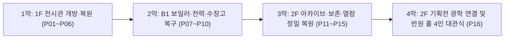
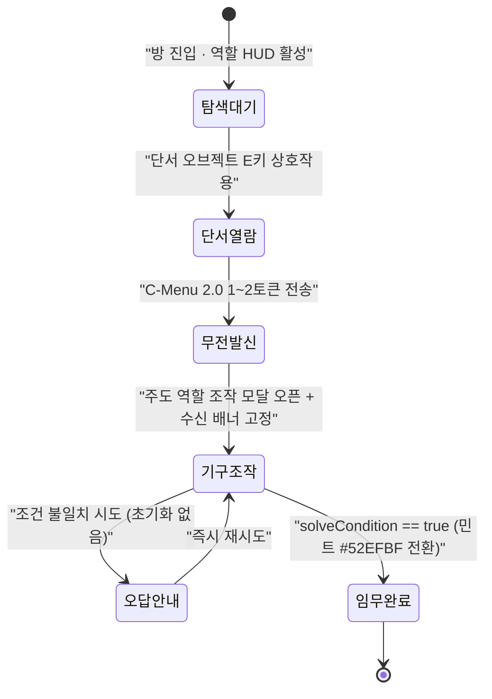

# STRANGER 2.0 · 16개 무반복 4인 협동 퍼즐 & UI 마스터 명세서

> **프로젝트**: UNESCO PARALLAX 4인 협동 픽셀 미스터리 게임 **STRANGER** (태풍으로 정전·침수된 필리핀 역사박물관)  
> **대상 연령**: 초등학교 5~6학년 ~ 중학교 1학년 (11~15세 · 비언어 협동 중심, 직관적 시각 단서, 즉각 재시도 보장)  
> **기본 맵 기준**: `STRANGER-Museum-Base/assets/map.json` (`2048×1664px`, 캐릭터 `30×50px`, `1F · 2F · B1` 총 13개 방)  
> **설계 원칙**: 기존 구버전 퍼즐의 반복(같은 카드 선택·단일 슬롯 대입 반복)을 **전면 폐기**하고, **16개 퍼즐 전부가 서로 다른 메커니즘 아키타입**을 가지며, **C-무전 2.0 조합 패킷**으로 모든 역할을 완벽하게 `4:4:4:4` 균등 분배한다.

---

## 1. 전술 무전 소통 시스템 (`C-Menu 2.0`: 4분류 20토큰 조합형)

기존의 단편적 14개 토큰으로는 공간·수치·문양·조작 타이밍을 입체적으로 전달할 때 표현력이 부족하므로, **4개 카테고리 · 20개 토큰의 방사형 무전 휠(Radial Radio Wheel)**로 전면 재설계한다.  
플레이어는 **단일 1토큰** 또는 **2토큰 조합 패킷**(`[토큰 A] + [토큰 B]`, 예: `[2번] + [파도 🌊]`, `[서 ←] + [회전 ↻]`)을 1회 무전으로 발신한다.

### 1-1. 20토큰 상세 명세

| 분류 | 토큰 표기 | 코드 (`id`) | 시각 배지 컬러 / 아이콘 | 색맹·저연령 보조 텍스트 | 주요 활용 맥락 |
| :--- | :---: | :--- | :---: | :--- | :--- |
| **① 수치·순서 (5종)** | `1번` | `NUM_1` | `#F4F7FA` / `①` | 숫자 `1` 강조 | 1번째 슬롯·카드·밸브·방울 수 |
| | `2번` | `NUM_2` | `#F4F7FA` / `②` | 숫자 `2` 강조 | 2번째 슬롯·카드·층·구역 |
| | `3번` | `NUM_3` | `#F4F7FA` / `③` | 숫자 `3` 강조 | 3번째 슬롯·배전반 베이·대각선 모서리 |
| | `4번` | `NUM_4` | `#F4F7FA` / `④` | 숫자 `4` 강조 | 4번째 천공 슬롯·구역 |
| | `기준(0)` | `NUM_0` | `#9AA7B4` / `◎0` | 기준점 `0` | 영점(`0°`)·기준선·원점 초기화 지시 |
| **② 방위·동작 (5종)** | `북 ↑` | `DIR_N` | `#52EFBF` / `↑` | `위 / 북` 라벨 병기 | 북측 수로·지도 상단·상층 선반 |
| | `동 →` | `DIR_E` | `#52EFBF` / `→` | `오른쪽 / 동` 라벨 | 뷰파인더 조망·우측 이동·프리즘 반사 |
| | `남 ↓` | `DIR_S` | `#52EFBF` / `↓` | `아래 / 남` 라벨 | 증기 감압·수압 하강·하단 배치 |
| | `서 ←` | `DIR_W` | `#52EFBF` / `←` | `왼쪽 / 서` 라벨 | 성문 좌측 정렬·좌측 레버 전환 |
| | `회전 ↻` | `ACT_ROT` | `#FFB86B` / `↻` | `돌리기` 화살표 | 원판·턴테이블·트레이싱 도면 회전 |
| **③ 문양·속성 (6종)** | `태양 ☀` | `SYM_SUN` | `#E6C886` (황금) | `☀ 태양(황금)` | 지붕 다락·황금 실·사료 도장·황산/호박 시약 |
| | `파도 🌊` | `SYM_WAVE` | `#7CD8FF` (청록) | `🌊 파도(청록)` | 해협·청록 실·수위/습도·청록 시약·물결 각인 |
| | `산맥 ⛰` | `SYM_MTN` | `#D49B6A` (황토) | `⛰ 산맥(황토)` | 고지대·가옥 하부 기둥·지형 기준점 |
| | `별자리 ★` | `SYM_STAR` | `#91A8FF` (감청) | `★ 별(감청)` | 바이바이인 음절·마이크로필름 좌표·왕실 각인 |
| | `열기 ⚡` | `SYM_VOLT` | `#FF6E6E` (적색) | `⚡ 고압/과열` | 적색 과압 밸브·고압 차단·적색 적열 |
| | `안정 🛡` | `SYM_SAFE` | `#52EFBF` (녹색) | `🛡 안정/건조` | 개방 안전 대역·건조 칸·장력 이완 완료 |
| **④ 협동 콜사인 (4종)** | `준비 완료` | `COOP_OK` | `#52EFBF` / `OK` | `✔ 완료/가능` | 사전 밸브·위상·정비 완료 보고 |
| | `잠깐 대기` | `COOP_WAIT` | `#FFB86B` / `HOLD` | `✋ 멈춤` | 실시간 게이지/동기화 정지 신호 |
| | `반전/교체` | `COOP_SWAP` | `#C792EA` / `⇄` | `⇄ 바꿈` | 모선 우회·대각선 순서 교체·위상 반전 |
| | `집결 호출` | `COOP_HERE` | `#52EFBF` / `★HERE` | `📍 여기로!` | 2F 반원 동상 홀 최종 합류 개시 |

### 1-2. 무전 패킷 방송 & 접근성 규칙
1. **조합 패킷 UX**: 플레이어가 C 키를 눌러 휠을 열면 `[첫 번째 토큰]` 클릭 시 즉시 **단일 발신(`[발신]` 버튼)** 하거나, `[두 번째 토큰]`을 연속 선택해 **2토큰 조합 패킷**으로 보낼 수 있다.
2. **상단 무전 수신 바 (Shared Radio Banner)**: 화면 상단 중앙 고정 배너에 `📡 [역할 색상] 발신자 · [아이콘+텍스트 A] + [아이콘+텍스트 B]` 형태로 12초간 유지되며, **현재 열린 퍼즐 모달 우측 상단에도 마지막 수신 패킷 2개가 고정(Pin)** 되어 초등학생도 암기 부담 없이 보드를 조작할 수 있다.
3. **색맹 배려 & 즉각 재시도**: 모든 문양·속성 토큰은 **고유 실루엣 + 색상 + 한글 텍스트** 3요소를 동시에 표기하며, 오답 조작 시 **페널티·진행 초기화 없이** 짧은 진동과 안내 문구(`"표시된 무전 신호와 다른 방향/수치입니다. 다시 맞춰 보세요."`)만 출력하고 즉시 재시도한다.

---

## 2. 4인 고정 역할 & 업무 균등 배분 (`4:4:4:4` + `5:5:5:5`)

네 명의 플레이어는 게임 시작 시 부여받은 직업을 **탐색·이동·퍼즐 전·후 과정 내내 그대로 유지**한다.

| 캐릭터 | 고유 컬러 | 직업 · 역할 | 평상시 탐색 HUD 특화 정보 | 주도(Main) 4퍼즐 | 단서/보조(Partner) 5퍼즐 | 피날레 |
| :--- | :---: | :--- | :--- | :--- | :--- | :---: |
| **도윤** | `#FFB86B` | **조작자 · 엔지니어** | 조작 가능 기계·밸브·로프·배전반에 황동 기어 하이라이트 | `P05, P07, P08, P09` | `P03, P10, P11, P13, P14` | `P16(4/4)` |
| **마리아** | `#E6C886` | **통역 · 고문서학자** | 방명록·연표·타갈로그/스페인어/바이바이인 문헌 번역 오버레이 | `P04, P11, P12, P15` | `P01, P02, P06, P13, P16(1부)` | `P16(4/4)` |
| **린** | `#52EFBF` | **네비게이터 · 공간측량사** | 미니맵 방위·배관 계통도·선로/광학 시선 벡터·마이크로필름 좌표 | `P01, P06, P10, P16` | `P04, P07, P09, P12, P15` | `P16(집결)` |
| **아이샤** | `#7CD8FF` | **관측자 · 유물감식가** | 회화·직물·유물 단면 확대 루페, UV/열화상/수압 파형 센서 뷰 | `P02, P03, P13, P14` | `P05, P08, P09, P10, P11` | `P16(4/4)` |

### 2-1. 4막 진행 동선 (Act 1 ~ Act 4)

---

## 3. 16개 무반복 퍼즐 마스터 일람표 (`P01` ~ `P16`)

아래 16개 퍼즐은 `STRANGER-Museum-Base/assets/map.json`의 13개 방 실제 오브젝트 ID와 정확히 1:1 매핑된다. 각 퍼즐은 메커니즘이 단 하나도 겹치지 않는다.

| ID | 층 · 방 (`room`) | 퍼즐 제목 | 메커니즘 아키타입 (무반복 16종) | 보조/단서 → **주도 조작** | 기본 맵 연동 오브젝트 ID (`추가 소품`) | 핵심 C-무전 2.0 패킷 |
| :---: | :--- | :--- | :--- | :--- | :--- | :--- |
| **P01** | `1F · hall` | 로비 나침반과 전시관 방위 개방 | **동심원 4방위 베젤 링 회전 정렬** | 마리아 → **린** | `hall-reception`, `floor-guide`, (`로비 나침반 조작 판`) | `[북 ↑]+[태양 ☀]`, `[남 ↓]+[파도 🌊]` |
| **P02** | `1F · life` | 바하이 쿠보 3층위 생활 유물 배치 | **전통 가옥 3단 단면 층위 드래그 슬롯** | 마리아 → **아이샤** | `life-wall-art`, `life-side-shelf-w`, `life-table-center` (`가옥 단면 유물 키트`) | `[1번]+[태양 ☀]`, `[3번]+[산맥 ⛰]` |
| **P03** | `1F · life` | 마눙굴 항아리 뚜껑 영혼의 배 복원 | **360° 턴테이블 회전 + 파편 음각 각도 조립** | 도윤 → **아이샤** | `life-case-nw`, `life-vitrine-ne` (`항아리 회전 받침`) | `[회전 ↻]+[파도 🌊]` |
| **P04** | `1F · time` | 군도 항해 지도와 3대 독립 연표 크로스라인 | **2D 고지도 X축 핀 × 타임라인 Y축 크로스 매칭** | 린 → **마리아** | `time-wall-art`, `time-long-shelf-ne`, `time-table-center` (`연표 크로스 보드`) | `[2번]+[서 ←]`, `[3번]+[북 ↑]` |
| **P05** | `1F · craft` | 이푸가오 전통 베틀 3색 씨실·날실 교차 | **3단 헤들(발판) 개구 토글 + 3색 북 왕복 시퀀스** | 아이샤 → **도윤** | `craft-wall-art`, `craft-basket-nw`, `craft-table-center` (`미니 베틀 모형`) | `[태양 ☀]+[열기 ⚡]`, `[파도 🌊]` |
| **P06** | `1F · city` | 1910 마닐라 전차 분기선과 파시그강 도개교 | **디오라마 선로 분기 레버 3종 + 뷰파인더 조준** | 마리아 → **린** | `city-wall-art`, `city-cabinet-nw`, `city-table-center` (`거리 모형·뷰파인더`) | `[2번]+[동 →]` |
| **P07** | `B1 · maintenance` | 지하 주 급수관 3구역 바이패스 수압 평형 | **연결형 합산 유량 밸브 분배 (과압 해소)** | 린 → **도윤** | `maint-pipe-header-1~3`, `maint-conduit-1~2`, `maint-pump-ne` | `[1번]+[열기 ⚡]`, `[3번]+[안정 🛡]` |
| **P08** | `B1 · safety` | 가압 보일러 증기 감압 & 복식 펌프 동기화 | **실시간 압력 안전대역 유지 + 듀얼 RPM 위상 동기화** | 아이샤 → **도윤** | `safety-console`, `safety-boiler`, `safety-pump`, `safety-side-pipe-w` | `[열기 ⚡]+[남 ↓]`, `[2번]+[안정 🛡]` |
| **P09** | `B1 · power` | 3연식 고압 배전반 모선 라우팅 & 발전기 기동 | **3베이 버스바 인터록 매트릭스 + 디젤 크랭크** | 린 + 아이샤 → **도윤** | `power-ups-e1/e2`, `power-conduit`, `power-generator`, `power-switchgear` | `[3번]+[반전 ⇄]`, `[준비 완료 OK]` |
| **P10** | `B1 · rescue` | 수장고 이슬점 제습 공조 & 2축 호이스트 이송 | **온습도 이슬점 캘리브레이션 + 침수 회피 크레인** | 아이샤 + 도윤 → **린** | `rescue-dehumid-nw`, `rescue-crate-sw1/2`, `rescue-table-c`, `rescue-rack-ne` | `[파도 🌊]+[북 ↑]`, `[1번]+[안정 🛡]` |
| **P11** | `2F · archive` | 카티푸난 비밀 헌장과 바이바이인 이중 암호판 | **고대 음절 문자(Kudlit) 2중 동심원 디코더 휠** | 아이샤 + 도윤 → **마리아** | `archive-paint`, `archive-long-nw/ne`, `archive-table` (`이중 해독 원판`) | `[별자리 ★]+[회전 ↻]`, `[3번]+[태양 ☀]` |
| **P12** | `2F · archive` | 기증 등록대장 마이크로필름 & 천공 카드 복원 | **XY 마이크로필름 스캐너 + 4열 천공 카드 타공** | 린 → **마리아** | `archive-side-desk-e`, `archive-cabinet-ne`, `archive-shelf-nw2` | `[2번]+[별자리 ★]`, `[4번]+[파도 🌊]` |
| **P13** | `2F · preserve` | 청동 유물 부식층 초음파 세척 & 3색 시약 적정 | **스포이드 3색 pH 7.0 적정 + 초음파 스케일링** | 마리아 + 도윤 → **아이샤** | `preserve-wall-chart`, `preserve-cabinet-1/2`, `preserve-lab-c` | `[파도 🌊]+[2번]`, `[태양 ☀]+[1번]` |
| **P14** | `2F · preserve` | 기증 상자 4점 도르래 이완 & 밀랍 봉인 몰드 | **4모서리 대각선 장력 평형 + 밀랍 인장 파편 압착** | 도윤 → **아이샤** | `preserve-crate-sw`, `preserve-crate-se`, `preserve-bench-r` | `[1번]+[반전 ⇄]`, `[안정 🛡]` |
| **P15** | `2F · reading` | 고서 지명 색인과 성곽 도면 트레이싱 오버레이 | **반투명 트레이싱지 X·Y·θ 정밀 포개기** | 린 → **마리아** | `reading-wall-art-c`, `reading-side-shelf-w`, `reading-side-desk-w`, `reading-table` | `[서 ←]+[회전 ↻]` |
| **P16** | `2F · special → atrium` | 해양 교역 프리즘 연결 & 반원 홀 4인 대관식 | **1부: 광학 프리즘 반사 정렬 + 2부: 필드 4/4 집결** | 마리아 + 도윤 + **린** → **4인 전원** | `special-wall-art`, `special-boat-nw`, `special-table`, `atrium-statue` (`inlay-1~4`) | `[동 →]+[회전 ↻]`, `[집결 호출 HERE]` |

---

## 4. 퍼즐별 상세 구현 명세 (`P01` ~ `P16`)

---

### Act 1 · 1F 상설 전시 구역 (`P01` ~ `P06`)

#### **P01. 로비 나침반과 4대 전시관 방위 개방** (`1F · hall` · 중앙 복도)
- **메커니즘**: 동심원 4방위 베젤 링 회전 정렬 (Concentric Compass Bezel Lock)
- **연결 오브젝트**: `hall-reception`(방명록 단서), `floor-guide`(층별 안내판), 로비 바닥 나침반 장미*(퍼즐 통합 시 상호작용 핫스폿 부여)*
- **역할 분담**:
  - **마리아 (단서)**: 안내 데스크(`hall-reception`)의 개관 당시 방명록을 통역해 4개 전시관의 문양·방위 짝(`생활사=북↑/태양☀`, `도시=남↓/파도🌊`, `역사=동→/별★`, `공예=서←/산⛰`)을 확인하고 C무전 발신 (`[북 ↑]+[태양 ☀]`, `[남 ↓]+[파도 🌊]`).
  - **린 (주도 조작)**: 바닥 중앙 나침반 모달에서 **외륜(방위 링)** 과 **내륜(전시관 문양 링)** 을 각각 클릭 회전시켜 4방위 포인터에 맞는 문양을 정확히 정렬한 뒤 중앙 황동 나침반 핀(`잠금 해제`)을 누른다.
- **데이터 & 판정 스키마**:
  - `initialState`: `{ outerDeg: 90, innerDeg: 180, locked: false }`
  - `solveCondition`: `outerDeg % 360 === 0 && innerDeg % 360 === 0 && locked === true`
- **오답 피드백 & 클리어**: 엇갈린 방위 슬롯이 주황 점멸하며 재회전 유도. 정렬 완료 시 `1F` 4개 전시실 문 위의 황동 표시등이 민트 `#52EFBF`로 점등.

#### **P02. 바하이 쿠보(Bahay Kubo) 3층위 생활 유물 배치** (`1F · life` · 생활사 전시실)
- **메커니즘**: 전통 가옥 3단 단면(지붕 다락·대나무 마루·고상 기둥 아래) 층위 슬롯 드래그 배치
- **연결 오브젝트**: `life-wall-art`(`bahay-painting.png`), `life-side-shelf-w`(서가), `life-table-center`(탁상 전시대 + `바하이 쿠보 3단 단면 모형`)
- **역할 분담**:
  - **마리아 (단서)**: 서측 서가(`life-side-shelf-w`)의 타갈로그어 생활 주석(`Silong=기둥 아래 ⛰`, `Sala=대나무 마루 🌊`, `Bubong=지붕 다락 ☀`)을 해독해 `[1번]+[태양 ☀]`, `[3번]+[산맥 ⛰]` 패킷 발신.
  - **아이샤 (주도 조작)**: 북측 회화(`life-wall-art`)의 창문·지붕 단서를 대조하며 `life-table-center` 단면도 위 **1층 다락(☀)**·**2층 마루(🌊)**·**지하 기둥(⛰)** 슬롯에 `① 건조 곡식 단지`, `② 대나무 직조 바구니`, `③ 돌절구`를 끌어다 놓는다.
- **데이터 & 판정 스키마**:
  - `initialState`: `{ slots: { roof: null, floor: null, stilt: null } }`
  - `solveCondition`: `slots.roof === "grain_jar" && slots.floor === "basket" && slots.stilt === "mortar"`
- **오답 피드백 & 클리어**: 층위가 틀린 유물만 트레이로 부드럽게 복귀하며 힌트 라벨 점등. 정답 배치 시 가옥 단면 모형 내부에 따뜻한 전구가 켜짐.

#### **P03. 마눙굴(Manunggul) 항아리 뚜껑 영혼의 배 복원** (`1F · life` · 생활사 전시실)
- **메커니즘**: 360° 원통 턴테이블 회전 + 파편 음각 기울기 결합
- **연결 오브젝트**: `life-case-nw`(`compact-pottery.png`), `life-vitrine-ne`(`tall-vitrine.png` + `턴테이블 감식대`)
- **역할 분담**:
  - **도윤 (단서)**: 북동측 수직 진열장(`life-vitrine-ne`) 하단 명판과 받침 톱니를 점검해 뚜껑과 몸체의 나선 파도 각인이 **`180°`(정반대 회전 방향)** 일 때 톱니가 물린다는 점을 확인하고 `[회전 ↻]+[파도 🌊]` 발신.
  - **아이샤 (주도 조작)**: `life-case-nw`의 확대 턴테이블을 `30°` 단위로 돌려 `180°`에 맞춘 뒤, 분리된 **두 영혼의 조각배 뚜껑 파편** 각도 다이얼을 물결선(`0°`)에 수평 결합한다.
- **데이터 & 판정 스키마**:
  - `initialState`: `{ turntableDeg: 60, lidTiltDeg: -15, seated: false }`
  - `solveCondition`: `turntableDeg % 360 === 180 && lidTiltDeg === 0 && seated === true`
- **오답 피드백 & 클리어**: 톱니 각도가 어긋나면 결합 버튼이 부르르 떨리며 각도 차이 표시. 완성 시 청동기 유물 스포트라이트 점등.

#### **P04. 군도 항해 지도와 3대 독립 연표 크로스라인** (`1F · time` · 역사 연표 전시실)
- **메커니즘**: 2D 고지도 해협 핀(X축) × 타임라인 연도 슬라이더(Y축: `1521 · 1898 · 1946`) 크로스 매칭
- **연결 오브젝트**: `time-wall-art`(`archipelago-map.png`), `time-long-shelf-ne`(역사 연표 서가), `time-table-center`(`연표 사료 전시대` + `지도·연표 크로스 보드`)
- **역할 분담**:
  - **린 (단서)**: 북측 군도 고지도(`time-wall-art`)에 표시된 3개 항해 거점 좌표(① 비사야 해협 `서 ←`, ② 마닐라만 북부, ③ 루손 내륙 `북 ↑`)의 순서와 방향을 읽고 `[2번]+[서 ←]`, `[3번]+[북 ↑]` 발신.
  - **마리아 (주도 조작)**: 서가 사료와 연표 전시대(`time-table-center`)에서 린의 방위 신호에 대응하는 연도(`① 1521 막탄 항해`, `② 1898 말롤로스 헌법`, `③ 1946 공화국 독립`) 핀 3개를 지도 위 점과 실(SVG Line)로 겹치지 않게 연결한다.
- **데이터 & 판정 스키마**:
  - `initialState`: `{ links: { "1521": null, "1898": null, "1946": null } }`
  - `solveCondition`: `links["1521"] === "visayas" && links["1898"] === "malolos" && links["1946"] === "manila_north"`
- **오답 피드백 & 클리어**: 잘못 연결된 선은 적색 점선으로 표시되며 클릭 한 번으로 재연결. 3선 완성 시 연표 유리 케이스가 투명하게 맑아짐.

#### **P05. 이푸가오 전통 베틀의 3색 씨실·날실 교차 직조** (`1F · craft` · 공예·기술 전시실)
- **메커니즘**: 3단 발판(헤들) 개구 토글 + 3색 북(Shuttle) 좌우 왕복 시퀀스
- **연결 오브젝트**: `craft-wall-art`(`textile-panel.png`), `craft-basket-nw`(`basket-case.png`), `craft-table-center`(`직조 전시대` + `전통 수직 베틀 키트`)
- **역할 분담**:
  - **아이샤 (단서)**: 북측 직조 벽면 직물(`craft-wall-art`)의 마름모 확대 루페로 **상단→중단→하단 3줄의 날실 개방 조합과 실 색상(`태양 황금` → `열기 적색` → `파도 청록`)** 을 관측하고 `[태양 ☀]+[열기 ⚡]`, 이어 `[파도 🌊]` 무전.
  - **도윤 (주도 조작)**: `craft-table-center` 베틀 조작 보드에서 ① 1~3번 헤들 발판을 밟아 해당 줄의 실틈을 벌리고 ② 맞는 색깔의 북을 좌↔우로 밀어 3줄의 전통 이푸가오 문양을 직접 짜낸다.
- **데이터 & 판정 스키마**:
  - `initialState`: `{ rowColors: [null, null, null], heddleOpen: [false, false, false] }`
  - `solveCondition`: `rowColors[0] === "gold" && rowColors[1] === "crimson" && rowColors[2] === "cyan"`
- **오답 피드백 & 클리어**: 엉뚱한 색 실을 넣으면 `[실 되감기]` 1클릭으로 해당 줄만 초기화. 3줄 완성 시 완성 천이 전시대에 걸림.

#### **P06. 1910 마닐라 전차(Tranvia) 분기선과 파시그강 도개교** (`1F · city` · 근현대 도시 전시실)
- **메커니즘**: 디오라마 선로 분기 레버 3종 전환 + 광학 뷰파인더 시선 각도 일치
- **연결 오브젝트**: `city-wall-art`(`historic-city-painting.png`), `city-cabinet-nw`(`archive-cabinet.png`), `city-table-center`(`옛 도시 도면 전시대` + `전차 디오라마 & 뷰파인더`)
- **역할 분담**:
  - **마리아 (단서)**: 거리화(`city-wall-art`) 속 구 스페인어 전차 푯말과 도시 보관장(`city-cabinet-nw`) 문서를 대조해 **2번 분기선(비논도 차이나타운 경유) → 동쪽(`→`) 도개교 방면** 운행 노선을 판독하고 `[2번]+[동 →]` 무전.
  - **린 (주도 조작)**: `city-table-center`의 미니어처 선로 분기 레버 `S1·S2·S3`을 조작해 `Intramuros → 2번 분기 → 도개교` 경로를 붉은 노선에서 민트 선로로 이은 뒤, 전차 조망 뷰파인더 다이얼을 **`90°(동 →)`** 에 맞춰 전차를 출발시킨다.
- **데이터 & 판정 스키마**:
  - `initialState`: `{ switches: ["A", "A", "B"], viewfinderDir: "N", dispatched: false }`
  - `solveCondition`: `switches[0] === "B" && switches[1] === "B" && switches[2] === "A" && viewfinderDir === "E" && dispatched === true`
- **오답 피드백 & 클리어**: 잘못된 선로로 출발 시 선로 끝 완충기에서 튕기며 안전 정지 후 재시도. 완주 시 도시 디오라마 가로등이 일제히 켜짐.

---

### Act 2 · B1 지하 설비 · 수장고 구역 (`P07` ~ `P10`)

#### **P07. 지하 주 급수관 3구역 바이패스 수압 평형** (`B1 · maintenance` · 관리 통로)
- **메커니즘**: 합산 목표 유량 분배 밸브 퍼즐 (적·황 핸드휠 다단 조절로 3구간 압력 `60 PSI` 평형)
- **연결 오브젝트**: `maint-pipe-header-1/2/3`(`b1-pipe-valve-wall.png`), `maint-conduit-1/2`(`b1-wall-conduit.png`), `maint-pump-ne`(`b1-pump-manifold.png`)
- **역할 분담**:
  - **린 (단서)**: `maint-conduit-1/2`의 전체 배관 계통도에서 3구역 허용 압력(`1번 구역 과압 ⚡ → 25%로 감압`, `2번 구역 유지`, `3번 구역 100% 개방 🛡`)을 읽고 `[1번]+[열기 ⚡]`, `[3번]+[안정 🛡]` 발신.
  - **도윤 (주도 조작)**: 통로 북측 벽면의 `maint-pipe-header-1~3` 핸드휠을 각각 `0 / 25 / 50 / 75 / 100%` 눈금으로 돌려 총합 유량 손실 없이 3개 아날로그 압력계 바늘을 모두 중앙 녹색 존(`55~65 PSI`)에 안착시킨다.
- **데이터 & 판정 스키마**:
  - `initialState`: `{ valves: [90, 50, 20] }`
  - `solveCondition`: `valves[0] === 25 && valves[1] === 50 && valves[2] === 100`
- **오답 피드백 & 클리어**: 과압 시 파이프가 떨리는 효과음만 발생하고 파열 없이 계속 조작 가능. 평형 달성 시 통로 바닥 배수 트렌치에 고인 물이 빠짐.

#### **P08. 가압 보일러 증기 감압과 복식 순환 펌프 동기화** (`B1 · safety` · 방재·보일러실)
- **메커니즘**: 실시간 보일러 압력 안전대역 유지 + 복식 모터 펌프 듀얼 RPM 위상 동기화
- **연결 오브젝트**: `safety-console`(`b1-control-console.png`), `safety-boiler`(`b1-boiler-tank.png`), `safety-pump`(`b1-pump-manifold.png`), `safety-side-pipe-w`(`b1-side-pipe-manifold-l.png`)
- **역할 분담**:
  - **아이샤 (단서)**: 방재 관제 콘솔(`safety-console`)의 듀얼 모니터에서 실시간 보일러 증기 과압(`⚡`) 경보와 목표 순환 펌프 회전수 대역(`2번 펌프 1200 RPM 안정 구간`)을 관측하고 `[열기 ⚡]+[남 ↓]`, `[2번]+[안정 🛡]` 발신.
  - **도윤 (주도 조작)**: ① 서측 수압 매니폴드(`safety-side-pipe-w`) 적색 배출 핸드휠을 돌려 보일러(`safety-boiler`) 압력을 적색 위험선에서 녹색 대역으로 낮춘 뒤, ② 복식 순환 펌프(`safety-pump`)의 1·2호기 RPM 페이더를 오차 `±30 RPM` 이내로 동기화하고 `[동기 잠금]` 스위치를 누른다.
- **데이터 & 판정 스키마**:
  - `initialState`: `{ steamValveOpen: false, boilerPsi: 145, pump1Rpm: 800, pump2Rpm: 1550, synced: false }`
  - `solveCondition`: `boilerPsi >= 70 && boilerPsi <= 90 && Math.abs(pump1Rpm - pump2Rpm) <= 30 && pump1Rpm >= 1150 && synced === true`
- **오답 피드백 & 클리어**: 보일러 과압 상태에서 동기 버튼을 누르면 안전 릴리프 밸브가 증기만 뿜고 리셋 없음. 동기 완료 시 방재실 경보등이 정상 녹색으로 복귀.

#### **P09. 3연식 고압 배전반 모선 라우팅 & 비상 디젤 발전기 기동** (`B1 · power` · 고압 전기실)
- **메커니즘**: 3베이(Bay 1·2·3) 고압 모선(Busbar) 인터록 매트릭스 + 디젤 발전기 예열·시동 크랭크
- **연결 오브젝트**: `power-ups-e1/e2`(`b1-ups-battery-side.png`), `power-conduit`(`b1-wall-conduit.png`), `power-generator`(`b1-diesel-generator.png`), `power-switchgear`(`b1-hv-switchgear.png`)
- **역할 분담**:
  - **린 (단서)**: 동측 UPS 배터리 랙(`power-ups-e1/e2`) 점검표에서 **1·2번 배터리 모선은 침수 단락, 3번 예비 우회 모선으로 교체 필요**임을 확인해 `[3번]+[반전 ⇄]` 무전.
  - **아이샤 (단서)**: 배선 계측 제어함(`power-conduit`)에서 발전기 예열 코일 전압 정상 reaching(`60Hz`) 확인 시 `[준비 완료 OK]` 발신.
  - **도윤 (주도 조작)**: ① 디젤 발전기(`power-generator`) 예열 스위치 2초 유지 후 시동 크랭크 기동 → ② 주 고압 배전반(`power-switchgear`) 3베이 내부의 단락된 Bus 1·2를 끄고 **Bus 3 우회 인터록**을 연결한 뒤 중앙 빨간 로터리 주 차단기를 투입한다.
- **데이터 & 판정 스키마**:
  - `initialState`: `{ genRunning: false, bus: [true, false, false], mainBreaker: false }`
  - `solveCondition`: `genRunning === true && bus[0] === false && bus[1] === false && bus[2] === true && mainBreaker === true`
- **오답 피드백 & 클리어**: 단락 모선이 켜진 상태로 차단기를 올리면 과전류 트립(자동 내려감)만 작동하고 재시도 가능. 성공 시 박물관 1F·2F 천장 비상등이 정식 조명으로 전환.

#### **P10. 수장고 이슬점 제습 공조 & 2축 천장 호이스트 이송** (`B1 · rescue` · 응급 수장고)
- **메커니즘**: 이슬점(온습도) 듀얼 다이얼 캘리브레이션 + 2축(X·Y) 천장 호이스트 크레인 침수 회피 이송
- **연결 오브젝트**: `rescue-dehumid-nw`(`b1-dehumidifier.png`), `rescue-crate-sw1/sw2`(`b1-sealed-crate.png`), `rescue-table-c`(`b1-steel-worktable.png`), `rescue-rack-ne`(`b1-steel-rack.png`)
- **역할 분담**:
  - **아이샤 (보조 조작)**: 항온·제습 공조 유닛(`rescue-dehumid-nw`)의 습도·온도 목표를 박물관 권장 보관 기준(`45% RH / 18°C`)으로 맞춘 뒤 수장고 남측 물웅덩이가 걷히는 북측 안전 구역을 확인하고 `[파도 🌊]+[북 ↑]` 발신.
  - **도윤 (단서·체결)**: 침수 구역 앞 `rescue-crate-sw1`의 방수 걸쇠와 중량 중심(`1번 크레이트 체결 OK`)을 고정하고 `[1번]+[안정 🛡]` 발신.
  - **린 (주도 조작)**: 2축 호이스트 크레인 컨트롤러(`▲▼◀▶` + `[인양/하강]`)를 움직여 바닥 침수 웅덩이를 피해 젖은 방수 상자를 **북동측 스틸 보관 선반(`rescue-rack-ne`) 2단** 위에 안전하게 내려놓는다.
- **데이터 & 판정 스키마**:
  - `initialState`: `{ targetRh: 72, targetTemp: 24, cratePos: { x: 1, y: 3 }, hookHeld: false }`
  - `solveCondition`: `targetRh === 45 && targetTemp === 18 && cratePos.x === 4 && cratePos.y === 1 && hookHeld === false`
- **오답 피드백 & 클리어**: 수장고 기둥에 크레인이 닿으면 자동 정지 버저가 울림. 선반 안착 시 크레이트 방수등이 녹색으로 점등.

---

### Act 3 · 2F 기록 · 보존 · 열람 정밀 복원 구역 (`P11` ~ `P15`)

#### **P11. 카티푸난 비밀 헌장과 바이바이인(Baybayin) 이중 암호판** (`2F · archive` · 기록 아카이브)
- **메커니즘**: 고대 필리핀 음절 문자(Baybayin) + 모음점(`Kudlit`) 2중 동심원 디코더 휠 정렬
- **연결 오브젝트**: `archive-paint`(`archive-frame.png`), `archive-long-nw/ne`(`archive-long-shelf.png`), `archive-table`(`archive-counter.png` + `바이바이인 해독 원판`)
- **역할 분담**:
  - **아이샤 (단서)**: 북측 헌장 액자(`archive-paint`) 속 지워진 3개 인장을 자외선 돋보기로 스캔해 상·하 모음점(`Kudlit`: 별자리 ★) 위치를 판독하고 `[별자리 ★]+[회전 ↻]` 무전.
  - **도윤 (단서)**: 북측 서가(`archive-long-nw/ne`)의 활자 대조 목판에서 3번째 키워드(`Ka - la - ya - an / 자유`, ☀ 태양 인장) 기준 각도를 확인해 `[3번]+[태양 ☀]` 무전.
  - **마리아 (주도 조작)**: 중앙 기록 열람대(`archive-table`) 위의 이중 동심원 디코더에서 **내륜(음절 자음)** 과 **외륜(Kudlit 점 위치: 위/아래/무점)** 을 돌려 헌장의 빈 3글자 암호(`KA - LA - YA`)를 완성한다.
- **데이터 & 판정 스키마**:
  - `initialState`: `{ slots: [{ syl: "BA", kudlit: "none" }, { syl: "MA", kudlit: "up" }, { syl: "PA", kudlit: "down" }] }`
  - `solveCondition`: `slots[0].syl === "KA" && slots[0].kudlit === "none" && slots[1].syl === "LA" && slots[1].kudlit === "none" && slots[2].syl === "YA" && slots[2].kudlit === "none"`
- **오답 피드백 & 클리어**: 음절 발음 미리보기가 실시간으로 낭독/표기되어 시행착오가 쉬움. 해독 성공 시 헌장의 숨은 서명이 금빛으로 복원.

#### **P12. 유물 기증 등록대장 마이크로필름 스캔 & 천공 카드 복원** (`2F · archive` · 기록 아카이브)
- **메커니즘**: XY 마이크로필름 필름 롤 스크롤 스캐너 + 4열 아카이브 천공(Punch) 카드 타공
- **연결 오브젝트**: `archive-side-desk-e`(`side-desk-right.png`), `archive-cabinet-ne`(`archive-cabinet.png`), `archive-shelf-nw2`(`stacked-records.png`)
- **역할 분담**:
  - **린 (단서)**: 동측 벽면 기록원 책상(`archive-side-desk-e`)의 마이크로필름 리더기 X·Y 휠을 돌려 흐릿한 필름 초점을 맞춘 뒤, 손실된 등록 카드의 **2열(★ 별 구역) · 4열(🌊 해양 유물)** 좌표를 읽고 `[2번]+[별자리 ★]`, `[4번]+[파도 🌊]` 무전.
  - **마리아 (주도 조작)**: 북동측 문서 보관장(`archive-cabinet-ne`) 위의 4열×4행 천공 카드 복원기에서 린이 불러준 열 좌표에 맞춰 펀치 레버로 구멍을 뚫고 금고 스탬프 인장을 찍는다.
- **데이터 & 판정 스키마**:
  - `initialState`: `{ focusSharp: false, holes: [false, false, false, false], stamped: false, holePattern: "" }`
  - `solveCondition`: `holePattern === "0-STAR-0-WAVE" && stamped === true`
- **오답 피드백 & 클리어**: 잘못 뚫은 구멍은 `[보수 테이프 붙이기]` 버튼으로 즉시 메우고 다시 타공. 완료 시 등록번호 전산화 완료 배지 획득.

#### **P13. 청동 유물 부식층 초음파 세척 & 3색 중화 시약 적정** (`2F · preserve` · 보존처리실)
- **메커니즘**: 스포이드 3색 시약 방울 적정(`pH 7.0` 중화 게이지) + 미세 초음파 스케일러 문지르기 세척
- **연결 오브젝트**: `preserve-wall-chart`(`archive-photo.png`), `preserve-cabinet-1/2`(`archive-cabinet.png`), `preserve-lab-c`(`lab-equipment-table.png`)
- **역할 분담**:
  - **마리아 (단서)**: 북측 보존 공정 기록(`preserve-wall-chart`)의 스페인어 화학 노트에서 **"청록 염화물(파도 🌊) 2방울, 중화 호박산(태양 ☀) 1방울 배합 시 pH 7.0"** 임을 해독해 `[파도 🌊]+[2번]`, `[태양 ☀]+[1번]` 발신.
  - **도윤 (보조)**: 북서측 약품 보관장(`preserve-cabinet-1/2`)에서 시약 공급 안전 밸브를 개방해 스포이드 사용 잠금 해제.
  - **아이샤 (주도 조작)**: 중앙 현미경·시약 작업대(`preserve-lab-c`)에서 청록·호박·투명 3개 스포이드로 비커에 방울을 떨어뜨려 pH 미터 바늘을 정중앙 `7.0`(녹색)에 맞춘 뒤, 초음파 펜 브러시로 청동 유물의 푸른 녹을 문질러 왕실 각인을 드러낸다.
- **데이터 & 판정 스키마**:
  - `initialState`: `{ drops: { cyan: 0, amber: 0, clear: 0 }, cleanPct: 0 }`
  - `solveCondition`: `drops.cyan === 2 && drops.amber === 1 && drops.clear === 0 && cleanPct >= 90`
- **오답 피드백 & 클리어**: 산성/염기성이 치우치면 비커가 연한 주황으로 변하며 `[증류수 헹굼(초기화)]` 버튼 즉시 제공. 완료 시 유물 본래의 청동 광택 복원.

#### **P14. 기증 상자 4점 도르래 이완 & 깨진 밀랍 봉인 몰드** (`2F · preserve` · 보존처리실)
- **메커니즘**: 4모서리 도르래 장력 평형 슬라이더(대각선 순서 미준수 시 자동 잠금) + 깨진 밀랍 인장 3조각 몰드 압착
- **연결 오브젝트**: `preserve-crate-sw`/`preserve-crate-se`(`rope-crate.png`), `preserve-bench-r`(`conservation-desk.png`)
- **역할 분담**:
  - **도윤 (단서)**: 남측 기증 상자(`preserve-crate-sw/se`) 측면 도르래 걸쇠의 장력 과부하 번호를 점검해 **1번(좌상) → 대각선 반대편 3번(우하) 순으로 먼저 풀어야 상자가 뒤틀리지 않음**을 파악하고 `[1번]+[반전 ⇄]`, 이어 `[안정 🛡]` 발신.
  - **아이샤 (주도 조작)**: 보존 복원 작업대(`preserve-bench-r`)에서 `1번→3번` 대각선 슬라이더를 `0%`로 낮춘 뒤 `2번→4번`을 풀어 상자를 열고, 내부에서 나온 **깨진 붉은 밀랍 봉인 3조각**을 회전·결합한 후 황동 인장 프레스로 `2초` 눌러 복원한다.
- **데이터 & 판정 스키마**:
  - `initialState`: `{ ropeTension: [100, 100, 100, 100], sealPiecesMatched: 0, pressed: false }`
  - `solveCondition`: `ropeTension.every(t => t === 0) && sealPiecesMatched === 3 && pressed === true`
- **오답 피드백 & 클리어**: 인접한 로프를 연속 풀면 `"대각선 장력 불균형! 반대편 로프를 먼저 푸세요"` 안내 후 해당 슬라이더만 원위치. 완료 시 기증 유물 인계 완료.

#### **P15. 고서 지명 색인과 성곽 건축 도면 트레이싱 오버레이** (`2F · reading` · 자료 열람실)
- **메커니즘**: 반투명 트레이싱지(Tracing Paper) 도면 레이어 X·Y 이동 및 θ 회전 정밀 포개기
- **연결 오브젝트**: `reading-wall-art-c`(`colonial-painting.png`), `reading-side-shelf-w`(`side-shelf-left.png`), `reading-side-desk-w`(`side-desk-left.png`), `reading-table`(`archive-counter.png`)
- **역할 분담**:
  - **린 (단서)**: 북측 사료화(`reading-wall-art-c`) 속 인트라무로스 성벽 종탑과 광장 축선을 측량해 **트레이싱 도면을 서측(`←`)으로 이동한 뒤 `90°` 시계 회전(`↻`)해야 기준점 3곳이 겹침**을 발견하고 `[서 ←]+[회전 ↻]` 무전.
  - **마리아 (주도 조작)**: 서측 참고 서가(`reading-side-shelf-w`)의 지명 색인으로 옛 스페인어 명칭(`Puerta Real`, `Baluarte`) 3곳을 식별한 뒤, 중앙 열람대(`reading-table`)의 반투명 찢어진 트레이싱지를 드래그(`X, Y`) 및 회전(`90°` 스냅)해 하단 석판 지도 위의 3개 앵커 핀과 `±8px` 이내로 포갠다.
- **데이터 & 판정 스키마**:
  - `initialState`: `{ overlayX: 120, overlayY: -40, overlayRot: 270 }`
  - `solveCondition`: `Math.hypot(overlayX, overlayY) <= 8 && overlayRot % 360 === 0`
- **오답 피드백 & 클리어**: 앵커 1개씩 맞을 때마다 핀 색상이 주황→민트 `#52EFBF`로 개별 점등되어 즉각 거리감 파악 가능. 3점 일치 시 복원 설계도 완성.

---

### Act 4 · 2F 기획전 연동 & 반원 홀 최종 피날레 (`P16`)

#### **P16. 해양 교역 프리즘 광학 연결 & 반원 홀 4인 대관식 집결** (`2F · special → atrium`)
- **메커니즘**: **2단계 연동 피날레** — `[1부: 기획전시실 다중 프리즘 빛 굴절 송출]` + `[2부: 모달 없는 인게임 필드 4인 문장 발판 동시 집결]`
- **연결 오브젝트**:
  - **1부 (`2F · special`)**: `special-wall-art`(`coastal-painting.png`), `special-boat-nw`(`boat-case.png`), `special-table`(`wide-display-table.png` + `해양 항해 프리즘 거치대`)
  - **2부 (`2F · atrium`, 인게임 필드 직접 조작)**: `atrium-statue`(`marble-statue.png`), `atrium-bust-l/r`(`stone-bust-case.png`), 중앙 나침반 장미 주변 **4방위 역할 문장 바닥 발판** *(퍼즐 통합 시 `inlay-1..4.png` 배치)*
- **역할 분담**:
  - **1부 (기획전시실 광학 송출 · 모달)**:
    - **마리아 (단서)**: 해양 벽화(`special-wall-art`) 속 고대 교역로 나침반 표기를 읽고 **`동쪽(→)` 항로 프리즘 각도 회전** 필요함을 `[동 →]+[회전 ↻]` 무전.
    - **도윤 · 린 (협동 조작)**: 목선 진열장(`special-boat-nw`)과 중앙 유리 전시대(`special-table`) 위 **3면 크리스탈 프리즘 미러**를 회전시켜 태양 스폿 광선이 서측 아치 문(`special-return`)을 통과해 `atrium` 중앙 동상으로 쏘아지게 만든다.
  - **2부 (반원 동상 홀 대관식 집결 · 모달 미사용 풀스크린 필드)**:
    - **린 (주도 호출)**: 빛이 반원 홀 중앙 동상(`atrium-statue`)의 월계관에 닿으면 린이 C메뉴 `[집결 호출 (HERE)]`를 발신한다.
    - **4인 전원 (도윤·마리아·린·아이샤)**: 각 플레이어의 캐릭터 초상화·역할 문장이 새겨진 나침반 둘레 **4개 바닥 발판** 위에 동시에 올라서면(`1/4 → 2/4 → 3/4 → 4/4`), 1층·지하·2층에서 복원한 15개 전시의 빛이 중앙 동상 대리석 감실로 모여 **박물관 전체 정식 개관 대관식 엔딩**이 재생된다.
- **데이터 & 판정 스키마**:
  - `initialState`: `{ phase: 1, prismAngles: [0, 45, 90], beamReachedAtrium: false, hereSent: false, padsActive: [false, false, false, false] }`
  - `solveCondition`: `beamReachedAtrium === true && hereSent === true && padsActive.every(Boolean)`

---

## 5. UI 프레임 및 6단계 상태 머신 규격

모든 퍼즐(`P01~P15` + `P16 1부`) 모달과 탐색 HUD는 다음의 일관된 상태 전이 규칙을 따른다.

### 5-1. 색상·비주얼 시스템 규격
- **주요 배경**: 딥 차콜 메탈 `#12161E` / 모달 베젤 `#242C36` (`4px solid #0B0E13`)
- **선택·신호·정답 강조**: 민트 `#52EFBF` (`STRANGER` 시그니처 하이라이트)
- **역할 식별 컬러**: 도윤 `#FFB86B` (주황) · 마리아 `#E6C886` (황동/금) · 린 `#52EFBF` (민트) · 아이샤 `#7CD8FF` (시안)
- **모달 밀도 기준**: 상단 헤더와 공용 무전 수신 바는 화면 상단 **15% 이내**로 압축하고, 나머지 **85% 이상을 실제 미니게임 조작 보드**로 사용한다.

---

## 6. `STRANGER-Museum-Base` 통합 로드맵

현재 기본 맵(`177`개 오브젝트, `puzzle_objects = 0`)에 위 16개 퍼즐을 얹을 때는 아래 순서를 따른다.
1. **기본 가구 위치 100% 보존**: 벽에 밀착된 서가·측면 진열장·3연 차단봉·B1 기계 설비의 기존 좌표와 충돌 영역은 그대로 유지한다.
2. **퍼즐 인터랙션 필드 바인딩 부여**: 위 §3·§4에 명시된 각 `STRANGER-Museum-Base` 오브젝트의 `"puzzles": [...]`, `"role": "..."` 필드를 업데이트하고, 필요시 `로비 나침반 조작 핀`, `탁상 위 미니어처/베틀/바이바이인 원판`, `2F 반원 홀 4인 발판(inlay-1..4.png)`만 해당 테이블/바닥 빈 공간 위에 겹쳐 배치한다.
3. **기존 프로토타입 동기화**: 확정된 16개 무반복 명세를 바탕으로 `STRANGER-Puzzle-UI-Prototype.html`의 `C-Menu 2.0` 무전 휠 및 `P01~P16` 보드 렌더러를 순차 구현한다.
